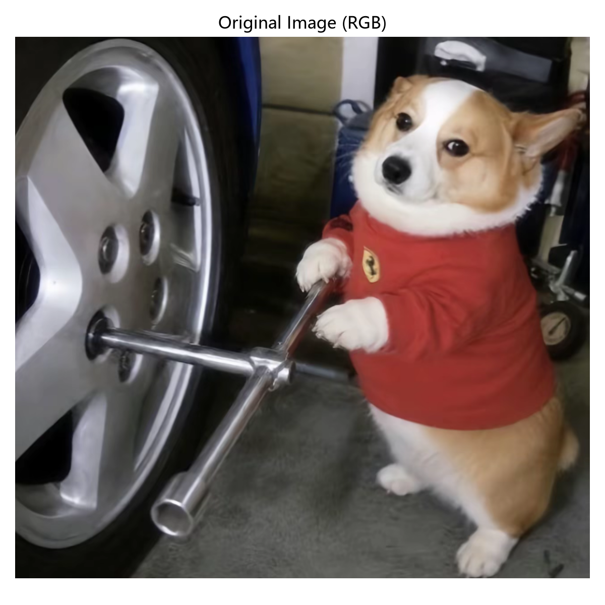
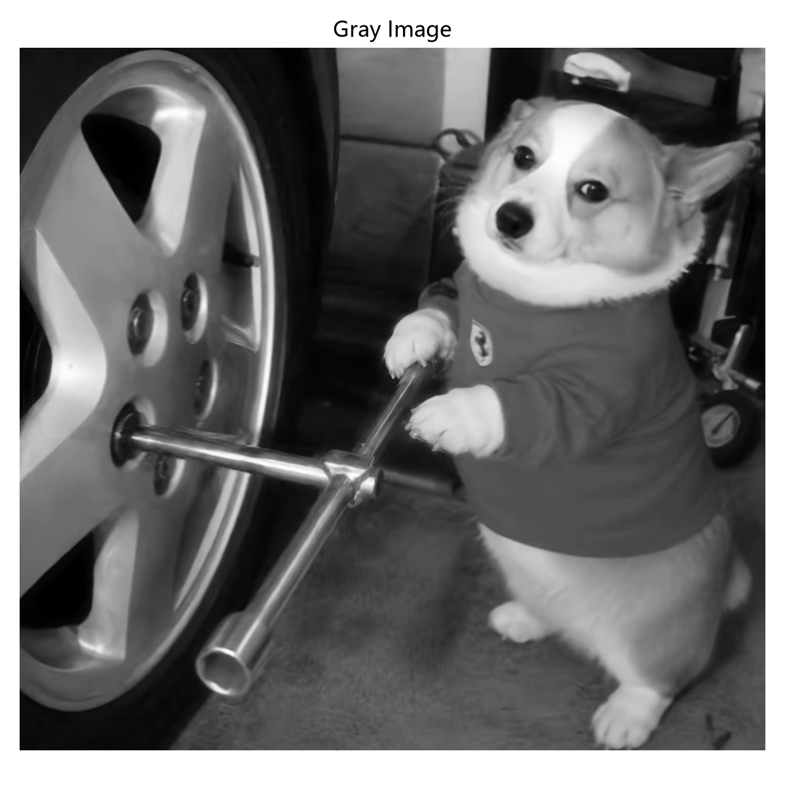
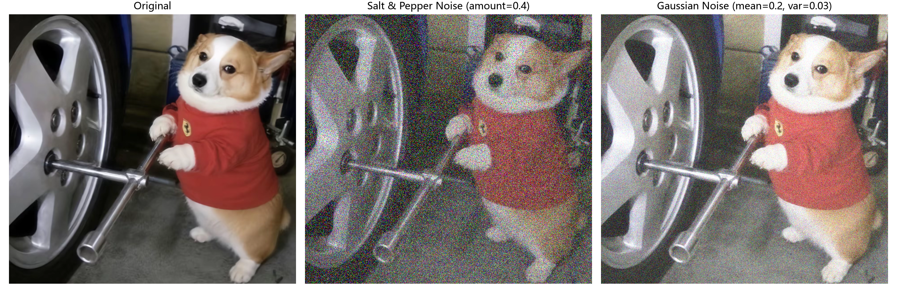
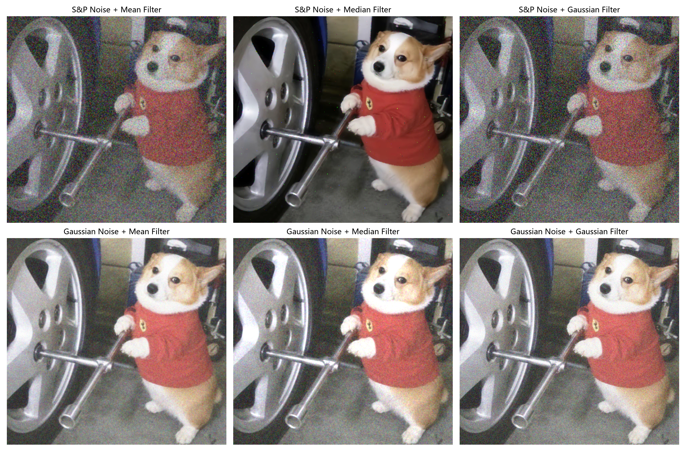

# 实验二：图像增强（Image Enhancement Lab）

使用 **OpenCV / scikit-image / NumPy / Matplotlib** 完成图像读取、色彩空间转换、噪声添加与空间滤波去噪对比。

## 一、实验环境


Python 3.10+

依赖安装：


```
pip install -r requirements.txt
```

## 二、项目结构


```
image_enhancement_lab/
├── input/
│   └── p1.png                 # 原始输入图像
├── output/                     # 运行后自动生成的结果图
│   ├── 01_original_rgb.png    # 原图（BGR->RGB 后正确显示）
│   ├── 02_gray.png             # 灰度图
│   ├── 03_noise_comparison.png # 原图 / 椒盐噪声 / 高斯噪声 三联对比
│   └── 04_filter_comparison.png# 六种滤波结果 2x3 对比
├── image_enhancement.py        # 主程序
├── requirements.txt
└── README.md
```

## 三、运行方式


```
python image_enhancement.py
```

运行后控制台会打印图像尺寸与 `(100, 100)` 处像素值，结果图全部输出到 `output/` 目录。

本实验输入图尺寸为 **1036 × 1100 × 3**，像素点 `(100, 100)` 位于画面左侧轮毂附近的暗部阴影，其 **BGR = (9, 14, 13)**，对应 **RGB = (13, 14, 9)**，接近黑色，与肉眼观察一致。

## 四、实验内容


1. **图像读取与色彩空间转换**：用 `cv2.imread` 读图，`cv2.cvtColor` 完成 BGR→RGB 与 BGR→GRAY 转换。

2. **添加噪声**：用 `skimage.util.random_noise` 分别添加椒盐噪声（`amount=0.4`）与高斯噪声（`mean=0.2, var=0.03`）。

3. **三种滤波对比**：对两种噪声图分别使用均值滤波 `cv2.blur`、中值滤波 `cv2.medianBlur`、高斯滤波 `cv2.GaussianBlur`（核大小均为 5×5）。

## 五、实验结果

### 1. 原图与灰度图







OpenCV 默认按 BGR 顺序读取，直接传给 matplotlib 会出现红蓝颠倒；转换为 RGB 后颜色显示正确。灰度图保留了亮度信息、去掉了色彩，便于后续分析边缘与亮度。

### 2. 噪声添加效果





（1）**椒盐噪声**：约 40% 像素被随机替换成纯黑或纯白（彩色图上表现为彩色噪点），是突变型噪声，画面里到处是离散的亮点和暗点。

（2）**高斯噪声**：每个像素叠加一个服从高斯分布的随机偏差，是连续型噪声，整张图亮度轻微抖动、像蒙了一层雾，但没有突兀的孤立点。

### 3. 滤波去噪对比





| 噪声类型 | 均值滤波           | 中值滤波            | 高斯滤波         |
| ---- | -------------- | --------------- | ------------ |
| 椒盐噪声 | 残留大量彩色噪点，且明显模糊 | 几乎完全去除噪点，边缘保留最好 | 残留较多噪点，仅轻微平滑 |
| 高斯噪声 | 平滑较自然，但边缘略糊    | 有一定抑制，画面略钝      | 平滑最自然，噪点抑制好  |

## 六、结果分析


**均值滤波**：用邻域像素的平均值替换中心像素，它的本质是低通平滑。其对高斯噪声这种连续叠加的噪声效果不错，但椒盐噪声的极值点也会被平均进邻域，结果是噪点扩散而且边缘也会糊。

**中值滤波**：取邻域像素的中位数。椒盐噪声的纯黑 / 纯白是邻域里的极值，排序后必然排到两端，取中位数时直接被丢掉，所以去椒盐噪声很干净，边缘可以清晰。而高斯噪声没有明显的极值，排序对它的帮助不大，效果一般。

**高斯滤波**：按二维高斯分布做加权平均，越靠近中心的像素权重越大。对高斯噪声平滑最自然，也保留了一部分边缘权重。但椒盐这种突变型点噪声，噪点的极值照样会被权重平均进来，无法清干净。

结论：椒盐噪声 → 中值滤波最优；高斯噪声 → 高斯滤波 / 均值滤波更合适。

## 实验总结

本次实验使用一张原始图片，让它进行了读图、色彩空间转换、加噪和三种空间滤波对比这几个实验任务，并且将几种噪声和滤波的效果放在一起对比。得到了以下几点认识：

1. OpenCV 的颜色顺序默认按 BGR 读图，但是matplotlib 默认按 RGB 显示，不做转换直接出图就会红蓝颠倒，此处颜色不统一的话会一直出错。

2. 应该先判断噪声类型，再选滤波算子。椒盐噪声是极值型突变，中位数排序天然能把它剔除；高斯噪声是连续叠加，只能靠邻域加权平均来平滑。各种方式的滤波对两种噪声各有优缺点。

3. 均值滤波去高斯噪声干净，但会模糊边缘；中值滤波保边好，但在纹理丰富的区域会丢失细节；核越大平滑越强、模糊也越严重，只能根据图像内容折中。

4. `skimage` 的 `random_noise` 输出是 `[0,1]` 的 float，OpenCV 的滤波函数要求 `uint8`，得先 `*255` 再转类型，不然结果会被截断或直接报错。

经过本次实验，对于一张带噪声的图，需要先看是离散的椒盐点还是整体发雾的高斯噪声，再决定用中值滤波还是均值 / 高斯滤波。之后如果尝试双边滤波、非局部均值、频域滤波这些更复杂的算法，可以使用这次的对比结果作为基准。
